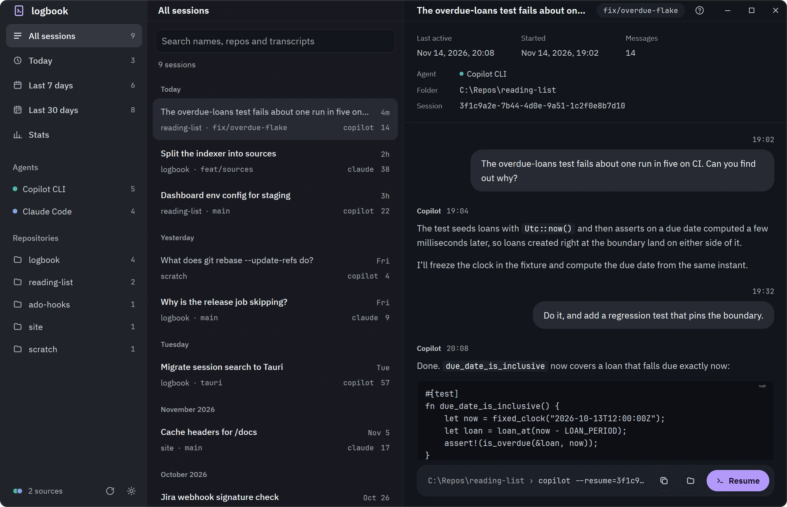
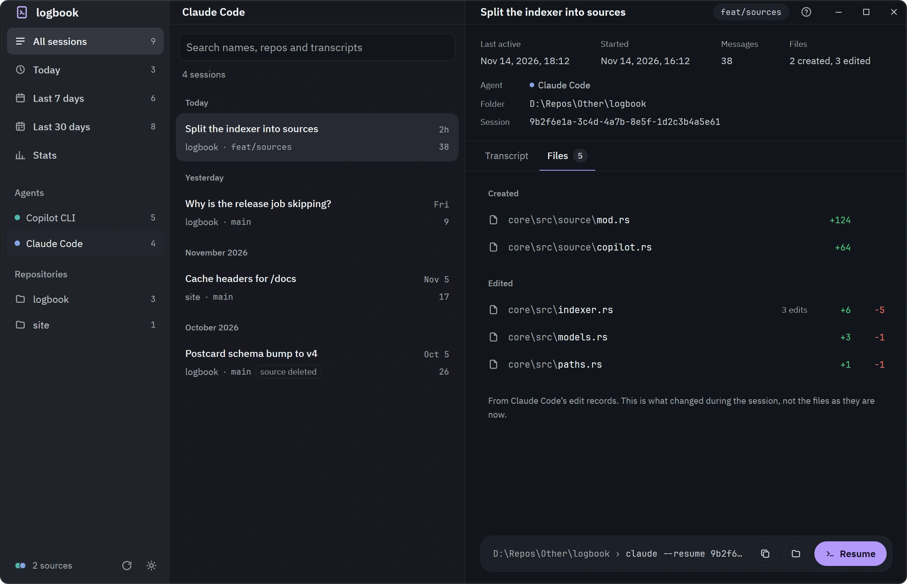
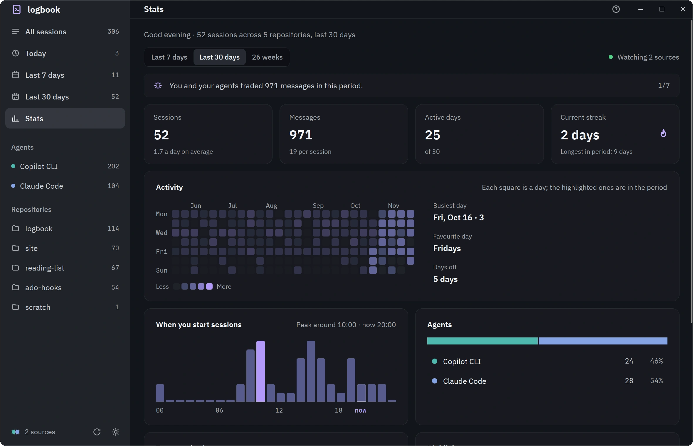

## Logbook

A logbook for your coding-agent sessions from the GitHub Copilot CLI and Claude Code: search,
browse and resume them from a desktop app.
A native Windows app written entirely in Rust, drawn with [GPUI](https://www.gpui.rs) (Zed's UI framework): no
webview. Laid out like [DevFlow](../ado-hooks): sidebar, list, detail.



- **Keyword search** over session names, full transcripts and the paths of files a session changed,
  with highlighted snippets. Paste a session id (or its first 8 characters, or a resume command) to find
  that session.
- **Time ranges**: all sessions, today, last 7 days, last 30 days (`1`–`4`).
- **Agents**: with sessions from both agents, filter to one from the sidebar (`Alt+1`, `Alt+2`).
- **Repositories**: filter to one repository from the sidebar.
- **Transcript view** with session metadata.
- **Files** (Claude Code): the files a session created and edited, with lines added and removed,
  each edit as a diff, and the shell commands that may have changed other files.
- **Stats** (`5`): sessions, messages and streaks for the last 7 days, 30 days or 26 weeks; a
  day-by-day activity map; when you start sessions; agents and top repositories; and a few
  highlights, like your chattiest session. New sessions appear live while it's open.
- **Resume**: opens a terminal in the session's folder running `copilot --resume=<id>` or
  `claude --resume <id>` (or **Copy** the command).
- **Incremental indexing**: a small `postcard` cache in your local app data folder; only
  sessions whose files changed get re-scanned. Re-indexes when the window
  regains focus, or press `r`.
- **Kept copies**: Claude Code deletes transcripts after 30 days (`cleanupPeriodDays`). Logbook
  keeps its own copy of every conversation it has read, so those sessions stay searchable and
  readable, marked "source deleted". They can't be resumed.
- **Updates**: when a new release is out, **Update** appears in the toolbar. **What's New** shows
  its release notes, and **Update now** downloads it, checks its signature, installs it and restarts.





Keyboard: `/` search · `↑`/`↓` move · `Enter` resume · `1`–`4` range · `5` stats · `Alt`+`1`–`2` agent · `Esc` close ·
`?` about · `Ctrl`+wheel zoom.

### Download

Windows installers are on the [releases page](https://github.com/etiennedelange/logbook/releases).

### Layout

| Path       | What                                                                                                    |
|------------|---------------------------------------------------------------------------------------------------------|
| `core/`    | Indexing and search engine (`logbook_core` lib) and `SessionService`                                    |
| `app/`     | The app: GPUI views and state (`src/`), and a plain-data library (`logbook_app`: the filters, formatting, stats, transcript and update logic) with its tests. `tauri.conf.json` only configures the installer maker |
| `site/`    | Marketing site: Astro, static, deployed to Cloudflare Workers (static assets)                          |
| `tools/`   | `release/` (version sync, release notes, `latest.json`), `screenshots/` (README and site images)       |

### Running

Requires Rust (stable). On Linux, GPUI also needs `libxkbcommon-dev libxkbcommon-x11-dev libxcb1-dev libfreetype-dev libfontconfig-dev`
(and a Vulkan driver to open a window); the dev container installs them. No Docker or server needed.

```bash
cargo run -p logbook             # the app; `--release` for a build to judge speed
cargo test --workspace           # the engine, the plain-data library, and the headless UI tests
```

`app/src/tests.rs` drives the real views in a headless window (real clicks and keys, a temporary history of Copilot CLI
and Claude Code sessions). Try the app on made-up sessions instead of your own:

```bash
app/tools/make-fixtures.py /tmp/lb small      # or `big 10000` for timing
COPILOT_HOME=/tmp/lb/copilot CLAUDE_CONFIG_DIR=/tmp/lb/claude LOGBOOK_CACHE_DIR=/tmp/lb/cache cargo run -p logbook
```

`LOGBOOK_TRACE=1` prints how long loading, filtering, searching and reading a transcript take; `LOGBOOK_DEV_UPDATE=1` shows
the update pill and What's New. `app/tools/drive.sh` runs the app in a virtual display, clicks and types, and takes
screenshots (Linux; needs Xvfb, xdotool and ImageMagick).

The Windows installer is made by the Tauri CLI's bundler from the built exe (`docs/RELEASING.md`); CI builds an unsigned one
on every run (Actions → CI → Artifacts), which can be installed over a released Logbook to try the update path.

Screenshots (the real app, made-up sessions, light and dark): `pnpm screenshots`, see `tools/screenshots/capture.mjs`.

The marketing site: `pnpm --dir site dev`.

Optional environment variables (handy for testing against other data):

| Variable            | Default           | Purpose                                         |
|---------------------|-------------------|-------------------------------------------------|
| `COPILOT_HOME`      | `~/.copilot`      | Root of the Copilot CLI's session data          |
| `CLAUDE_CONFIG_DIR` | `~/.claude`       | Root of Claude Code's data (`projects/` is read) |
| `LOGBOOK_CACHE_DIR` | OS local data dir | Where this app's own `index-v6.bin` cache and settings live |

The app never reads `~/.copilot/session-store.db`; that SQLite file belongs to the
Copilot CLI itself. It never writes to either agent's folder.

### Releasing

A version bump and a tag: see [docs/RELEASING.md](docs/RELEASING.md).
