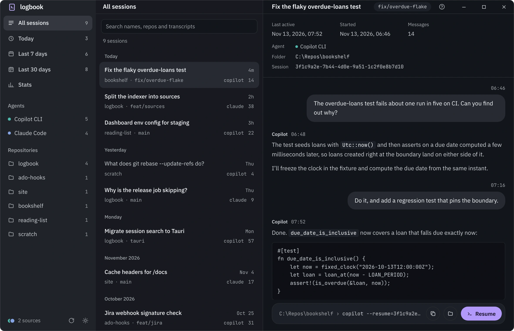

## Logbook

A logbook for your GitHub Copilot CLI sessions: search, browse and resume them from a desktop app.
Built with Tauri 2 (Rust) and React, laid out like
[DevFlow](../ado-hooks): sidebar, list, detail.



- **Keyword search** over session names and full transcripts, with highlighted snippets.
- **Time ranges**: all sessions, today, last 7 days, last 30 days (`1`–`4`).
- **Repositories**: filter to one repository from the sidebar.
- **Transcript view** with session metadata.
- **Resume**: opens a terminal in the session's folder running `copilot --resume=<id>`
  (or **Copy** the command).
- **Incremental indexing**: a small `bincode` cache in your local app data folder; only
  sessions whose `events.jsonl` changed get re-scanned. Re-indexes when the window
  regains focus, or press `r`.

Keyboard: `/` search · `↑`/`↓` move · `Enter` resume · `Esc` close · `?` about · `Ctrl`+wheel zoom.

### Download

Windows installers are on the [releases page](https://github.com/etiennedelange/logbook/releases).

### Layout

| Path         | What                                                                                      |
|--------------|-------------------------------------------------------------------------------------------|
| `core/`      | Indexing and search engine (`logbook_core` lib) and `SessionService`                      |
| `src-tauri/` | Tauri shell: commands the UI calls, background indexing, single instance                  |
| `ui/`        | React 19 + TypeScript + Tailwind 4 + zustand, built with [Vite+](https://viteplus.dev)    |
| `site/`      | Marketing site: Astro, static, deployed to Cloudflare Pages                               |
| `tools/`     | `screenshots/` (Playwright, mock data) and `release/` (version sync)                      |

### Running

Requires Rust (stable), Node and pnpm. No Docker or server needed.

```bash
pnpm install
pnpm tauri dev      # dev window with hot reload
pnpm tauri build    # release build and NSIS installer
```

Work on the UI alone, in a browser, against fake data:

```bash
pnpm mock:web      # same as: pnpm --dir ui dev:mock
```

Screenshots (real UI, fake sessions, light and dark; one-time `pnpm --dir tools/screenshots exec playwright install chromium`):

```bash
pnpm screenshots            # every scene; the published ones land in docs/screenshots/
pnpm screenshots search     # one scene
pnpm --dir site dev         # the marketing site
```

Releasing is a version bump and a tag: see [docs/RELEASING.md](docs/RELEASING.md).

Checks:

```bash
cargo test                 # core tests
pnpm --dir ui check        # Vite+: format, lint, types
pnpm --dir ui test         # UI tests
```

Optional environment variables (handy for testing against other data):

| Variable            | Default           | Purpose                                         |
|---------------------|-------------------|-------------------------------------------------|
| `COPILOT_HOME`      | `~/.copilot`      | Root of the Copilot CLI's session data          |
| `LOGBOOK_CACHE_DIR` | OS local data dir | Where this app's own `index-v3.bin` cache lives |

The app never reads `~/.copilot/session-store.db`; that SQLite file belongs to the
Copilot CLI itself.
